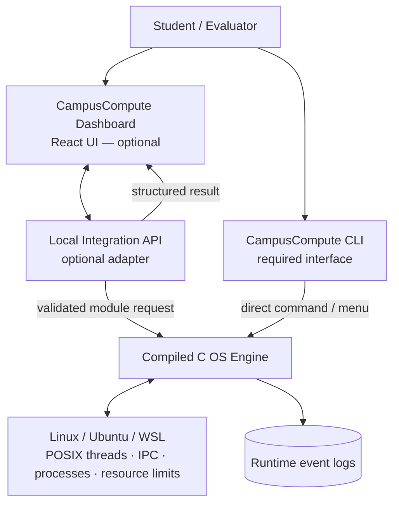
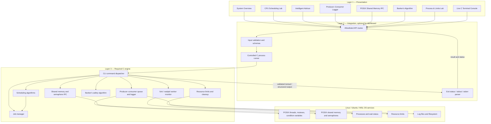
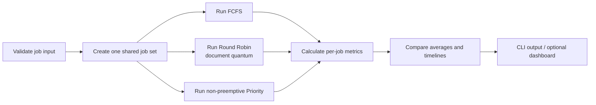
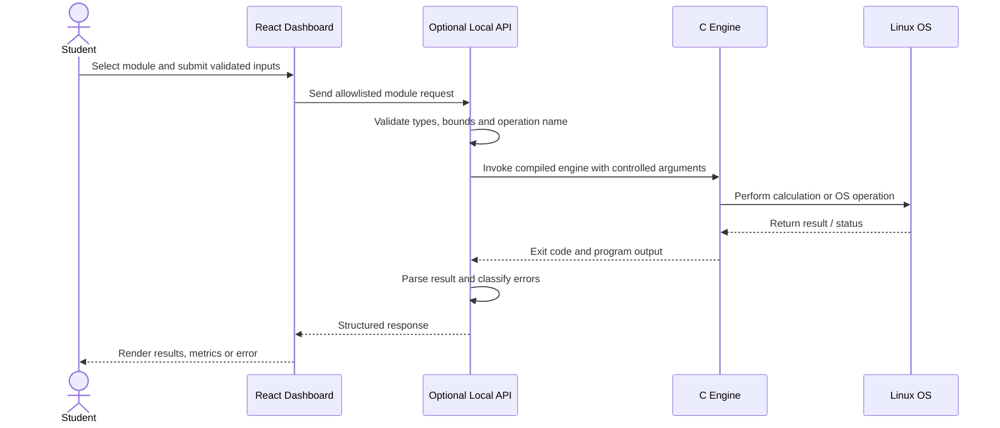
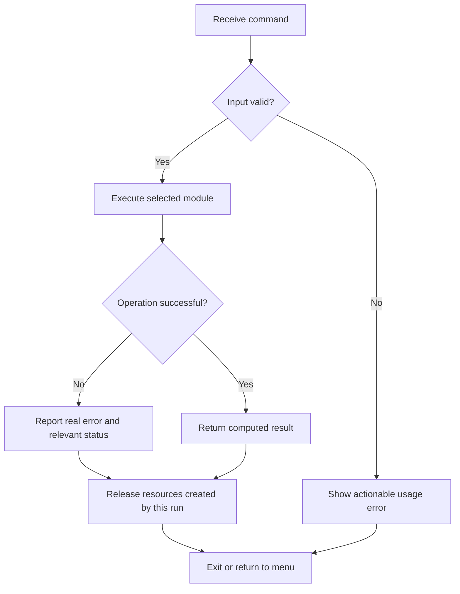

# CampusCompute — Architecture

This document defines the planned architecture for the CampusCompute Level 3 Operating Systems mini-project. It is an architecture specification, not a claim that all modules have already been implemented.

## 1. System context



**Design rule:** the C engine is the source of truth for operating-system demonstrations and computed results. The dashboard is optional and must not replace the required CLI or fake results. The integration API is optional; if implemented, it should expose only allowlisted operations rather than arbitrary shell execution.

## 2. Layered architecture



The direct CLI path runs the C engine without requiring the optional frontend or API. The diagram shows logical responsibilities; actual files can be consolidated or split as implementation evolves.

## 3. Module responsibilities and data flow

| Module | Inputs | Core responsibility | Outputs |
|---|---|---|---|
| Job manager (FR1) | Job ID, arrival time, burst, priority | Validate jobs and track lifecycle/status | Validated job set and statuses |
| Scheduling engine (FR2) | Same job set and selected policy | FCFS, Round Robin, non-preemptive Priority | Execution intervals, completion time, turnaround time, waiting time, averages |
| Producer–consumer logger (FR3) | Events to record | Bounded queue; producer/consumer threads; mutex and condition variables; orderly shutdown | Log entries and thread completion status |
| Shared-memory IPC (FR4) | Message/data payload | Exchange data between cooperating processes using POSIX shared memory and semaphore/suitable synchronization | Received payload and cleanup status |
| Banker's safety engine (FR5) | Available, Allocation, Maximum | Compute Need = Maximum − Allocation and run safety check | Safe sequence or unsafe-state result |
| Worker monitor (FR6) | Normal or controlled-failure mode | Create child process and collect status using fork()/waitpid() or documented equivalent | Accurate exit/failure classification |
| Resource limits (FR7) | Chosen supported limit and workload | Apply a limit using setrlimit() or suitable Linux mechanism and observe effect | Limit configuration, observed outcome and cleanup |
| CLI and validation (FR8) | Command/menu input | Dispatch only supported commands and handle malformed input | Usage/help, results and actionable errors |

## 4. Scheduling result flow



For each policy, define tie-breaking explicitly. The same input job set should be used for comparisons, and all timeline and metric values must be calculated by the implementation.

## 5. Runtime request sequence (dashboard mode)



If no API is implemented, the user runs the same supported operation directly through the CLI. Never expose a raw shell prompt backed by unrestricted server-side command execution.

## 6. Error handling and resource lifecycle



Cleanup rules:

- Join threads and signal shutdown cleanly.
- Reap child processes and report their actual exit status.
- Unlink only shared-memory objects and semaphores created by this program.
- Close descriptors and release allocated memory.
- Keep generated logs separate from source files.
- Clearly label controlled simulated worker failures; do not describe them as real OS failures.

## 7. Proposed repository layout

```text
CampusCompute/
├── README.md
├── ARCHITECTURE.md
├── frontend/                 # optional React dashboard
│   └── src/
│       ├── components/
│       ├── layouts/
│       ├── pages/
│       └── services/
├── backend/                  # optional local integration API
│   ├── main.py
│   ├── routes/
│   └── services/
├── engine/                   # required C engine
│   ├── include/
│   ├── src/
│   │   ├── main.c
│   │   ├── job_manager.c
│   │   ├── scheduler.c
│   │   ├── producer_consumer.c
│   │   ├── shared_memory.c
│   │   ├── banker.c
│   │   └── process_limits.c
│   └── Makefile
├── tests/
└── logs/                     # runtime output; usually ignored by Git
```

This is a proposed structure, not a verified inventory of current files. File names and interfaces should be reconciled with the implementation before build commands are documented as final.

## 8. Implementation order

1. Build a working C CLI and Makefile first.
2. Implement and test job management and all three scheduling policies.
3. Implement the producer–consumer logger with safe thread shutdown.
4. Implement shared-memory IPC and semaphore cleanup.
5. Implement Banker's safety checks for both safe and unsafe test states.
6. Implement worker completion/failure detection and a resource-limit demonstration.
7. Add robust validation, error handling, tests and integrated CLI scenarios.
8. Add the optional API and dashboard, then connect UI modules to real engine results.
9. Capture genuine assessment evidence only after the relevant features work.

## 9. Verified integration contract (current implementation)

The diagrams above describe logical architecture. The following reflects the repository as it exists today.

### Runtime topology

\`\`\`mermaid
flowchart LR
    Browser[React dashboard :5173] -->|GET health / module inventory; POST producer events| API[FastAPI adapter 127.0.0.1:8000]
    API -->|fixed argv, shell disabled| FR3[FR3 producer-consumer executable]
    FR3 -->|temporary TSV log + stdout summary| API
    API -->|JSON result / safe HTTP error| Browser
    CLI[Direct Linux terminal] --> FR1[FR1 job manager CLI]
    CLI --> FR2[FR2 scheduler CLI]
    CLI --> FR3
    CLI --> FR5[FR5 Banker's CLI]
\`\`\`

The adapter is optional. If it is stopped, the C module CLIs remain usable directly. Only FR3 currently has a non-interactive API operation because its executable accepts command-line arguments and a log path. FR1, FR2 and FR5 are implemented C modules, but their current entry points are interactive menus; this API does not fake or simulate their engine results. FR4, FR6, FR7 and the integrated FR8 dispatcher remain not implemented.

### API contract

| Method | Route | Request | Success response |
|---|---|---|---|
| GET | \`/health\` | None | Service status and module capability states |
| GET | \`/api/modules\` | None | Module availability and API support |
| POST | \`/api/producer-consumer?event_count=12\` | Integer query parameter, 1–100000 | \`status\`, \`source: "C engine"\`, requested count, parsed real event records, and C summary |

Errors use FastAPI JSON error responses. Invalid counts return HTTP 422; missing GNU Make or build/start failures return HTTP 503; execution timeout returns HTTP 504. C stderr/stdout details are bounded before returning. No route accepts shell text, an executable path, a working directory or arbitrary arguments from the browser.

### Ownership and lifecycle

- The UI owns transient form state only. It is not persistent job state.
- The C FR3 executable is the authority for producer/consumer synchronization and event creation.
- The adapter validates the event count, builds the specific FR3 binary when it is missing, executes that fixed binary with an argv list and \`shell=False\`, parses the temporary TSV, and removes the temporary directory on exit.
- Requests time out after 15 seconds; on timeout the request is reported as failed rather than returning a fabricated result.
- Default CORS permits only \`http://127.0.0.1:5173\` and \`http://localhost:5173\`; the API binds to loopback in the documented command. This is a local coursework adapter, not an internet-facing service.
- Build or test the C engine independently. The API must never replace the direct CLI contract.

### Reproducible development commands

From the repository root in Ubuntu/WSL:

\`\`\`bash
# C module checks
make -C engine/src/job_manager clean test
make -C engine/src/scheduler clean test
make -C engine/src/producer_consumer clean test
make -C engine/src/banker clean test

# Local adapter
python3 -m venv .venv
. .venv/bin/activate
python -m pip install -r backend/requirements.txt
PYTHONPATH=backend pytest -q backend/tests
uvicorn app.main:app --app-dir backend --host 127.0.0.1 --port 8000
\`\`\`

In a second terminal, run \`cd frontend && npm install && npm run dev\`. Test API availability at \`http://127.0.0.1:8000/health\` and inspect the generated OpenAPI docs at \`http://127.0.0.1:8000/docs\`.

### Integration work still required

To make FR1, FR2 and FR5 dashboard actions call the real engine, refactor their existing C core APIs behind a non-interactive structured interface (JSON or another versioned format) rather than piping prompts into interactive menus. When FR4, FR6, FR7 and FR8 are implemented, add each operation to the explicit allowlist, define strict schemas and tests, then update \`/api/modules\`. Until then, dashboard labels must preserve the current unavailable/CLI-only state.
